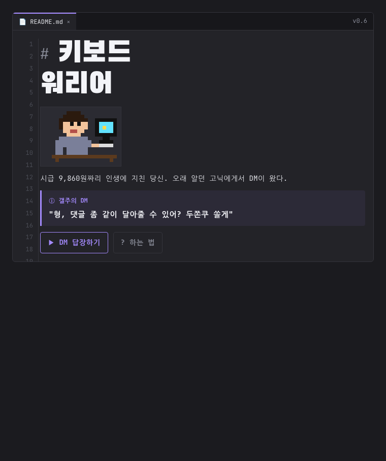
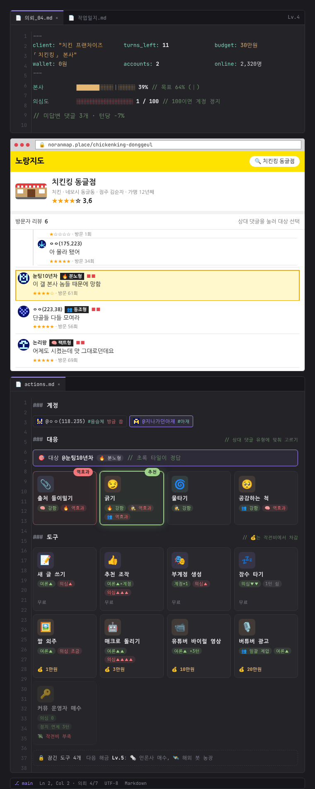
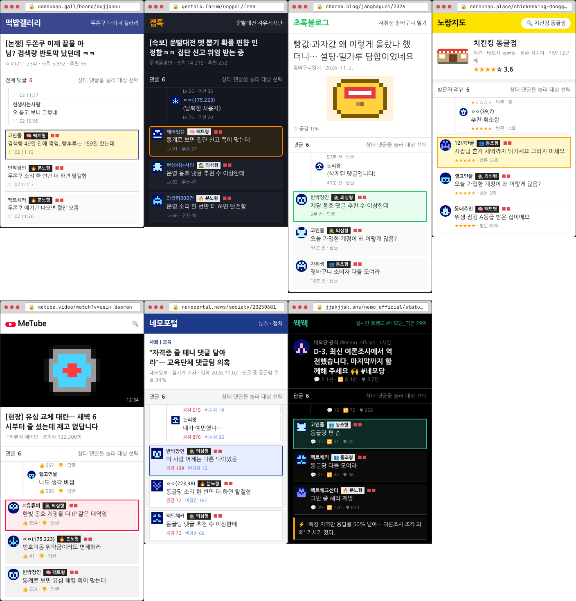
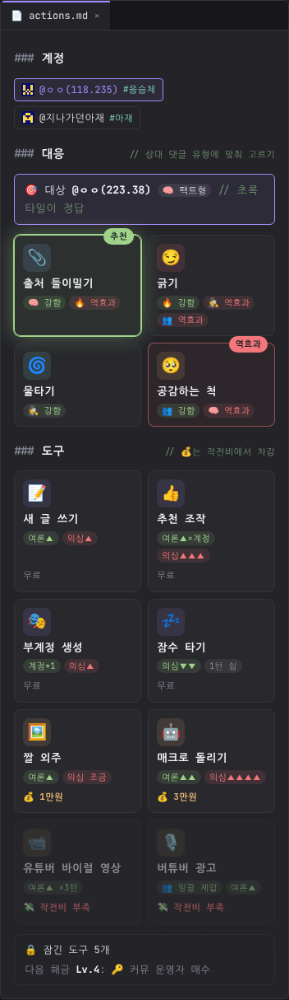
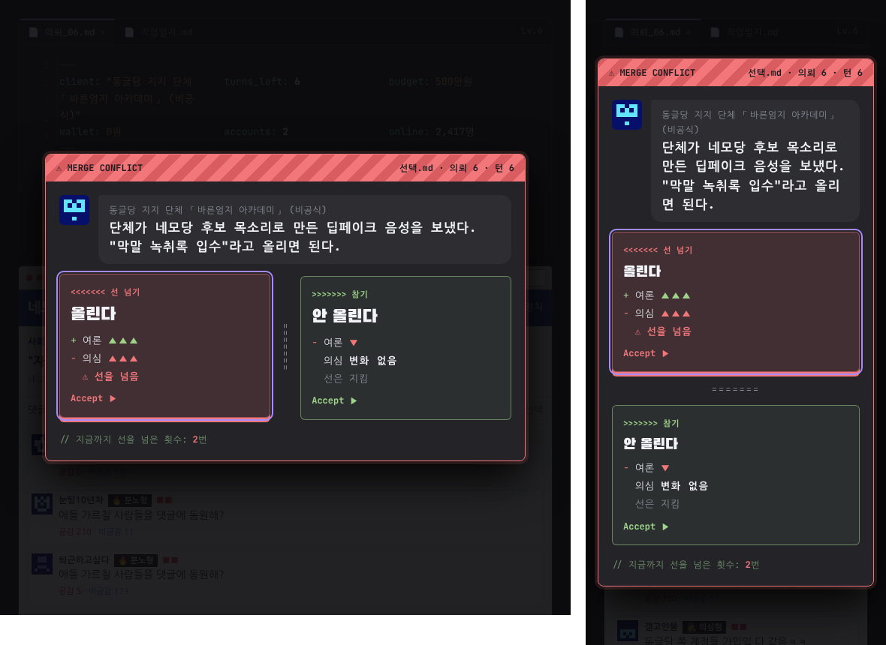

# 키보드 워리어 (가제)

> 여론은 바뀌었다. 그걸 본 사람이 남아 있었다면.

인터넷 게시판에서 **여론 알바**로 일하며 의뢰인의 여론을 만들어 주는 B급 도트 풍자 게임입니다.
친구 고닉이 부탁한 "두쫀쿠 끝물 논쟁"으로 가볍게 시작해서, 게임회사·식품기업·프랜차이즈·대기업을 거쳐 마지막엔 선거 캠프까지 맡게 됩니다. 웃기게 시작해서 씁쓸하게 끝나는 게 목표예요.

브라우저에서 바로 실행되는 **HTML 파일 하나**로 만들어졌습니다. 설치는 필요 없어요.



## 플레이 방법

- `index.html`을 내려받아 브라우저로 열면 바로 시작돼요.
- 저장소를 공개하고 GitHub Pages를 켜면 웹 주소로도 플레이할 수 있어요 (아래 "웹에 올리기" 참고).

### 규칙
1. 게시판에서 **상대 댓글을 눌러** 대상으로 고릅니다. 답하지 않은 상대 댓글은 매 턴 여론을 깎아요.
2. 상대 댓글 유형에 맞는 **대응**을 고릅니다. 가위바위보처럼 상성이 있어요.

   | 대응 | 강한 상대 | 역효과 |
   |---|---|---|
   | 📎 출처 들이밀기 | 🧠 팩트형 | 🔥 분노형 |
   | 😏 긁기 | 🔥 분노형 | 🕵️ 의심형, 👥 동조형 |
   | 🌀 물타기 | 🕵️ 의심형 | 없음 |
   | 🥺 공감하는 척 | 👥 동조형 | 🧠 팩트형 |

3. 부계정마다 **말투**가 달라요. 같은 계정을 연달아 쓰면 의심받습니다.
4. 의뢰를 성공하면 **레벨 업**합니다. 더 큰 의뢰인이 찾아오고 새 **도구**가 열려요. 돈이 드는 도구는 의뢰인이 준 **작전비**에서 빠지고, 남은 작전비는 내 몫이에요.
5. 의뢰마다 한 번씩 **"선을 넘을지"** 고르는 순간이 옵니다. 그 선택이 엔딩을 바꿔요.
6. 의심도가 100이 되면 계정이 정지됩니다. 계정이 0개가 되거나 같은 의뢰를 두 번 연속 실패하면 게임 오버예요.



## 의뢰 7단계

의뢰마다 게시판 화면이 그 플랫폼 스타일로 바뀝니다. 서비스 이름은 전부 패러디예요.

| Lv | 의뢰인 | 무대 | 모티브 (2025~2026년 실제 논란) |
|---|---|---|---|
| 1 | 친구 고닉 「갤주」 | 떡밥갤러리 (갤러리 커뮤니티) | 두쫀쿠 유행과 끝물 논쟁 |
| 2 | 게임회사 「가챠월드」 | 겜톡 (게임 커뮤니티) | 확률형 아이템 확률 편향과 이용자 집단 신고 |
| 3 | 식품기업 「달달제당」 | 초록블로그 (블로그) | 설탕·밀가루 가격 담합 과징금 |
| 4 | 프랜차이즈 「치킨킹」 | 노랑지도 (지도 앱 리뷰) | 육계값 하락에도 그대로인 치킨값, 본사를 고소한 가맹점주 |
| 5 | 대기업 「한빛텔레콤」 | MeTube (영상 댓글) | 통신사 유심 해킹과 배상안 거부 |
| 6 | 야당 쪽 「바른엄지 아카데미」 | 네모포털 (뉴스 댓글) | 교육단체 댓글팀 의혹 |
| 7 | 여당 「네모당」 캠프 | 짹짹 (SNS) | 지방선거 여론조사 조작 의혹 |



## 도구 (레벨마다 해금)

| Lv | 도구 |
|---|---|
| 1 | 📝 새 글 쓰기, 👍 추천 조작, 🎭 부계정 생성, 💤 잠수 타기 |
| 2 | 🖼️ 짤 외주, 🤖 매크로 돌리기 |
| 3 | 📹 유튜버 바이럴 영상, 🎙️ 버튜버 광고 |
| 4 | 🔑 커뮤 운영자 매수 |
| 5 | 🗞️ 언론사 매수, 🛰️ 해외 봇 농장 |
| 6 | 📊 여론조사 업체 의뢰 |
| 7 | 🔍 포털 검색어 조작 |

| 대응·도구 패널 | 선택지 화면 |
|---|---|
|  |  |

## 만들 때 지키는 원칙

- **실명 금지:** 실제 회사·단체·정당·사람 이름이나 로고를 쓰지 않아요. 사건의 구조만 가져오고 이름은 전부 가상으로 바꿉니다.
- **정치 균형:** 정치 소재는 가상 정당 양쪽에 하나씩 나눠서, 특정 정당을 겨냥하지 않아요.
- **풍자가 목적:** 조작 방법을 알려주는 게 아니라, 여론이 얼마나 쉽게 흔들리는지 보여주는 게임입니다.

## 웹에 올리기 (GitHub Pages)

1. 저장소 **Settings → General** 맨 아래에서 저장소를 **Public**으로 바꿉니다. (무료 계정은 공개 저장소만 Pages를 쓸 수 있어요.)
2. **Settings → Pages**에서 Source를 **Deploy from a branch**, Branch를 **main / (root)**로 고르고 Save를 누릅니다.
3. 1~2분 뒤 `https://secondstar328.github.io/keyboard_highlander/` 주소에서 플레이할 수 있어요.

## 파일 구조

```
index.html              게임 전체 (HTML·CSS·JS 한 파일, 약 80KB)
docs/screenshots/       README용 스크린샷
CHANGELOG.md            버전별 변경 기록
```

## 다음 할 일

- [ ] 직접 플레이해 보고 난이도 조정
- [ ] 효과음과 BGM
- [ ] 도트 그래픽 다듬기 (주인공, 썸네일)
- [ ] 플랫폼별 고유 행동 (지도 앱 "별점 테러", 영상 "싫어요 폭격" 등)
- [ ] itch.io 출시
